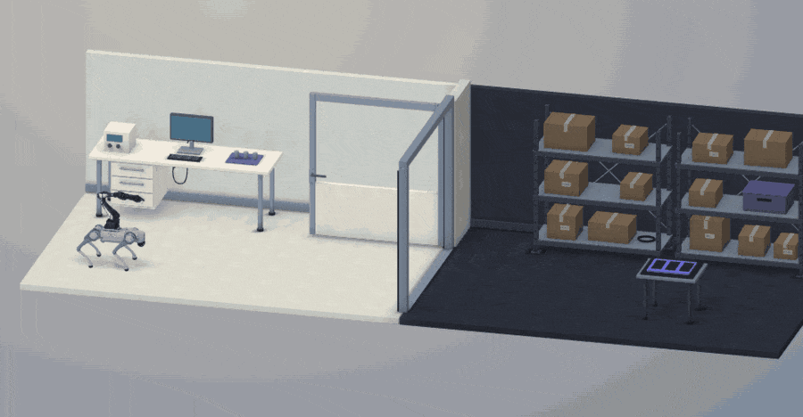
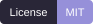
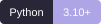
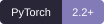
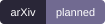

<p align="center">
  <a href="https://nebulis-lab.com/UniGeom/#application">
    
  </a>
  <br />
  <sub>Scripted application illustration.</sub>
</p>

<h1 align="center">UniGeom</h1>
<p align="center"><strong>Shared Geometry for World Models</strong></p>

<p align="center">
  <a href="https://nebulis-lab.com/UniGeom/"></a>
  <a href="LICENSE"></a>
  <a href="pyproject.toml"></a>
  <a href="pyproject.toml"></a>
  <a href="https://github.com/NEBULIS-Lab/UniGeom/actions/workflows/tests.yml"></a>
  <a href="#project-links"></a>
</p>

<p align="center">
  Shuaijun Liu<sup>1</sup> · Feiyang You<sup>1</sup> · Qifu Wen<sup>2,3</sup> · Shuyang Hao<sup>1</sup><br />
  Xingwei Chen<sup>3,4</sup> · Chenglong Zhang<sup>1</sup> · Chengyu Wu<sup>1</sup> · Ningxin Su<sup>1,*</sup>
</p>
<p align="center">
  <sup>1</sup> The Hong Kong University of Science and Technology (Guangzhou)<br />
  <sup>2</sup> Boston University · <sup>3</sup> Shanghai Jiao Tong University<br />
  <sup>4</sup> Eastern Institute of Technology, Ningbo<br />
  <sup>*</sup> Corresponding author: <a href="mailto:ningxinsu@hkust-gz.edu.cn">ningxinsu@hkust-gz.edu.cn</a>
</p>

UniGeom provides compact PyTorch interfaces between independently trained world-model components. Calibrate an adapter using paired features from common observations, then pass the mapped features to a frozen receiver’s dynamics model. Both pretrained components remain frozen.

The package includes:

- Global ridge maps with an optional trainable residual MLP.
- Ordered spatial and pooled readouts from token grids to global states.
- Token-to-token resampling with residual attention, fixed bilinear interpolation, or a depthwise convolution residual.
- Calibration statistics, state-only adapter fitting, and frozen receiver rollout utilities.

## Install

```bash
git clone https://github.com/NEBULIS-Lab/UniGeom.git
cd UniGeom
python -m venv .venv
source .venv/bin/activate
python -m pip install --upgrade pip
python -m pip install 'torch>=2.2' --index-url https://download.pytorch.org/whl/cpu
python -m pip install -e '.[test]'
python -m pytest -q
python examples/synthetic_calibration.py
```

See [installation](docs/installation.md) for environment and dependency details.

## A small CPU example

This example uses synthetic paired vectors and requires no pretrained models or datasets.

```python
import torch
from unigeom import RidgeResidualMap

torch.manual_seed(0)
source = torch.randn(64, 8)                 # [observations, source channels]
target = source @ torch.randn(8, 6) + 0.1  # [observations, receiver channels]

adapter = RidgeResidualMap.fit(source, target, residual=False)
mapped = adapter(torch.randn(4, 8))
assert mapped.shape == (4, 6)
```

The [synthetic example](examples/synthetic_calibration.py) also trains a residual map, fits a small spatial adapter, and runs autoregressive prediction through a frozen receiver.

## Train on paired features

Save paired tensors in a `.pt` dictionary with keys `source`, `target`, and `trajectory_ids`. The training CLI expects an explicit history axis: global features are `[N, H, C]`, and patch features are `[N, H, P, C]`. See the [cache format and interface options](docs/integration.md#paired-feature-training-cli).

```bash
python examples/train_paired.py paired_features.pt \
  --interface spatial-attention --output adapter.pt --steps 1000
```

```python
from unigeom.checkpoint import load_adapter

adapter = load_adapter("adapter.pt")
# mapped = adapter(source_features)
```

The CLI runs on CPU by default, splits by trajectory, and fits normalization on training rows. Load only trusted feature caches and checkpoints.

## Feature layouts

Each paired row comes from the **same observation**. Spatial tokens follow a consistent raster order, with any class token removed before adapting them.

| Interface                         | Source features  | Receiver features |
| --------------------------------- | ---------------- | ----------------- |
| `RidgeResidualMap`                | `[N, C_A]`       | `[N, C_B]`        |
| `SpatialReadout`, `PooledReadout` | `[N, P, C_A]`    | `[N, C_B]`        |
| `SpatialResampler`                | `[N, G_A², C_A]` | `[N, G_B², C_B]`  |

Here `N` is the number of paired observations, `P` is the source token count, and `G_A` / `G_B` are square grid sizes. Split trajectories into calibration and evaluation sets before fitting statistics or adapters. Adapter outputs are restored to receiver coordinates before prediction.

See [integration](docs/integration.md) for calibration, encoder extraction, spatial adapter choices, and rollout contracts.

## Project links

[Explore the interactive project page](https://nebulis-lab.com/UniGeom/) for the method, measured geometry, recorded comparisons and manuscript. An arXiv link will be added when available.

## License

This code is available under the [MIT license](LICENSE). External encoders, receiver models, datasets, and their weights retain their respective licenses.
